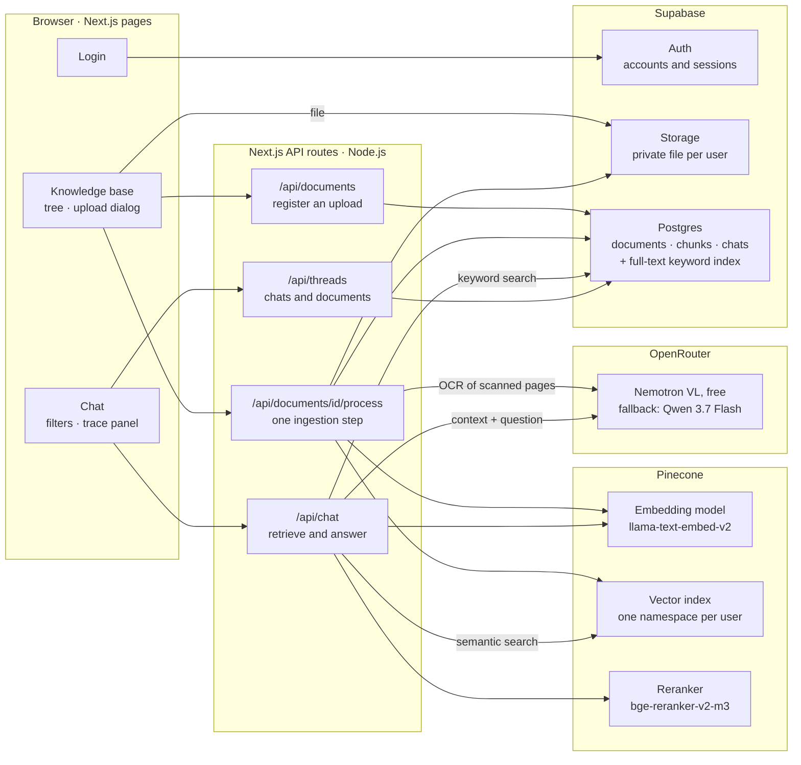
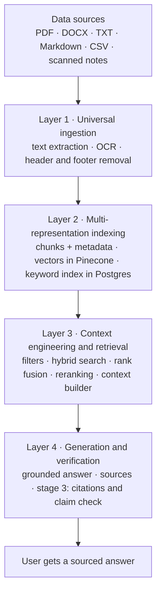
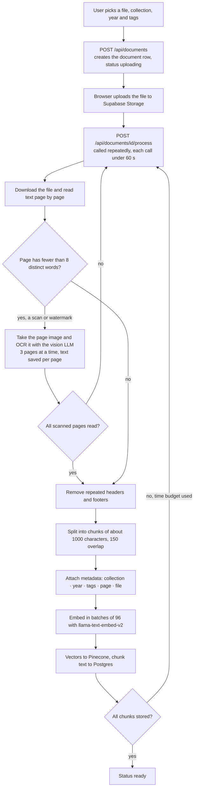
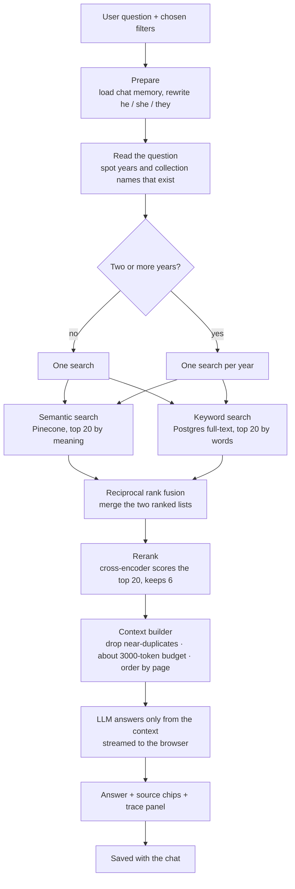
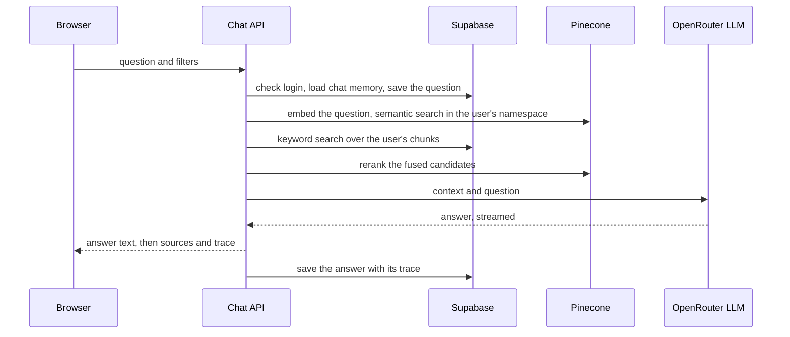
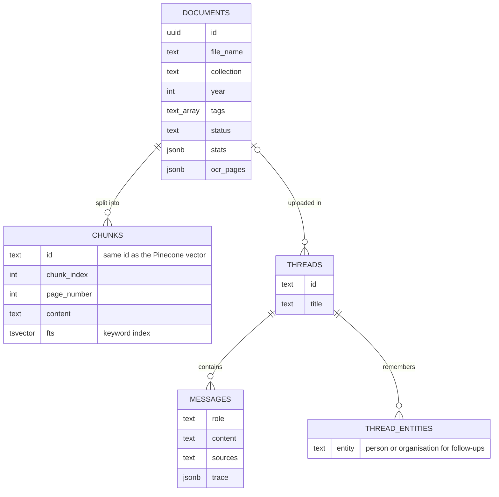

# RAGStack: architecture and flows

How the parts of RAGStack fit together, how a document becomes searchable, and how a question becomes
an answer. Diagrams are Mermaid: they render on GitHub, in VS Code (with a Mermaid extension) and at
[mermaid.live](https://mermaid.live), where they can also be exported as images for slides.
For the presentation script, see [PRESENTATION_GUIDE.md](PRESENTATION_GUIDE.md).

---

## 1. System architecture

| Part | Role |
|---|---|
| **Browser** | The three pages the user sees. Files are uploaded straight to Supabase Storage, not through the server |
| **Next.js API routes** | The backend: check the login, run ingestion steps, run retrieval and call the LLM |
| **Supabase** | Accounts, the database (documents, chunk text, chats, traces), private file storage, and keyword search |
| **Pinecone** | Turns text into vectors, stores them per user, and reranks search candidates |
| **OpenRouter** | One API for many LLMs: the free model reads scanned pages and writes answers; the paid fallback steps in when it is busy |

---

## 2. The synopsis layers

---

## 3. Ingestion: from upload to searchable

**Why steps?** A serverless request may run for at most 60 seconds, so a big file is processed over many
short calls. Everything is resumable: OCR text is saved per page and chunk ids are fixed, so a repeated
step never duplicates work. A page whose OCR loops or stalls is re-read by the fallback model.

---

## 4. Answering a question (stage 2)

Stage 3 adds two steps after the answer: numbered `[n]` citations in the text, and a second LLM pass
that checks every claim against the passages.

---

## 5. One chat request, step by step

---

## 6. Data model

Every table also has a `user_id`, and row-level security lets each user see only their own rows.
In Pinecone, each chunk is a vector of 1024 numbers stored under the user's own namespace, with
metadata (document id, file name, page, collection, year, tags) used for filtering.

---

## 7. What each stage shows

| Feature | Stage 1 | Stage 2 | Stage 3 |
|---|:-:|:-:|:-:|
| Upload with steps, OCR, header removal, chunking, embedding | ✅ | ✅ | ✅ |
| Knowledge base tree with metadata | ✅ | ✅ | ✅ |
| Semantic search, grounded answers, source chips, "not found" refusal | ✅ | ✅ | ✅ |
| Chat memory and follow-up rewriting | ✅ | ✅ | ✅ |
| Basic trace (query, similarity-ranked chunks, timings) | ✅ | ✅ | ✅ |
| Filters by collection, year, document ("Ask about this in chat") | | ✅ | ✅ |
| Keyword search + reciprocal rank fusion | | ✅ | ✅ |
| Reranking | | ✅ | ✅ |
| Year detection and per-year comparison searches | | ✅ | ✅ |
| Full trace (S/K ranks, rerank scores, searches) | | ✅ | ✅ |
| Inline `[n]` citations | | | ✅ |
| Claim-by-claim answer check | | | ✅ |
| Evaluation page | | | ✅ |

Set with `NEXT_PUBLIC_DEMO_STAGE` in `.env.local` (currently 2), then restart the dev server.

---

## 8. Where each box lives in the code

| Box | File |
|---|---|
| Upload dialog and its steps | `components/upload/UploadDialog.tsx` |
| Knowledge base page and tree | `app/knowledge/page.tsx`, `components/knowledge/NodeDetail.tsx` |
| Chat page, filters, trace panel | `app/page.tsx`, `components/chat/ChatShell.tsx`, `components/chat/TraceDetails.tsx` |
| Ingestion steps | `lib/rag/ingest.ts`, `app/api/documents/[id]/process/route.ts` |
| Reading PDFs and page images | `lib/pdf/pdfjs.ts`, `lib/pdf/loader.ts` |
| OCR | `lib/pdf/ocr.ts` |
| Header/footer removal, scan detection | `lib/pdf/parse.ts` |
| Chunking and metadata | `lib/rag/chunking.ts`, `lib/rag/metadata.ts` |
| Embeddings and Pinecone | `lib/ai/embeddings.ts`, `lib/pinecone/vector-store.ts` |
| Query understanding | `lib/rag/query-understanding.ts` |
| Semantic search and filters | `lib/rag/retrieve.ts` |
| Keyword search | `lib/db/chunks.ts`, `search_chunks_keyword` in `supabase/schema.sql` |
| Rank fusion, reranking, orchestration | `lib/rag/fusion.ts`, `lib/rag/rerank.ts`, `lib/rag/hybrid.ts` |
| Context builder | `lib/rag/context.ts` |
| Answer generation and prompts | `lib/rag/answer.ts`, `lib/ai/prompts.ts`, `lib/ai/model.ts` |
| Chat API | `app/api/chat/route.ts` |
| Stage switch | `lib/stage.ts` |
