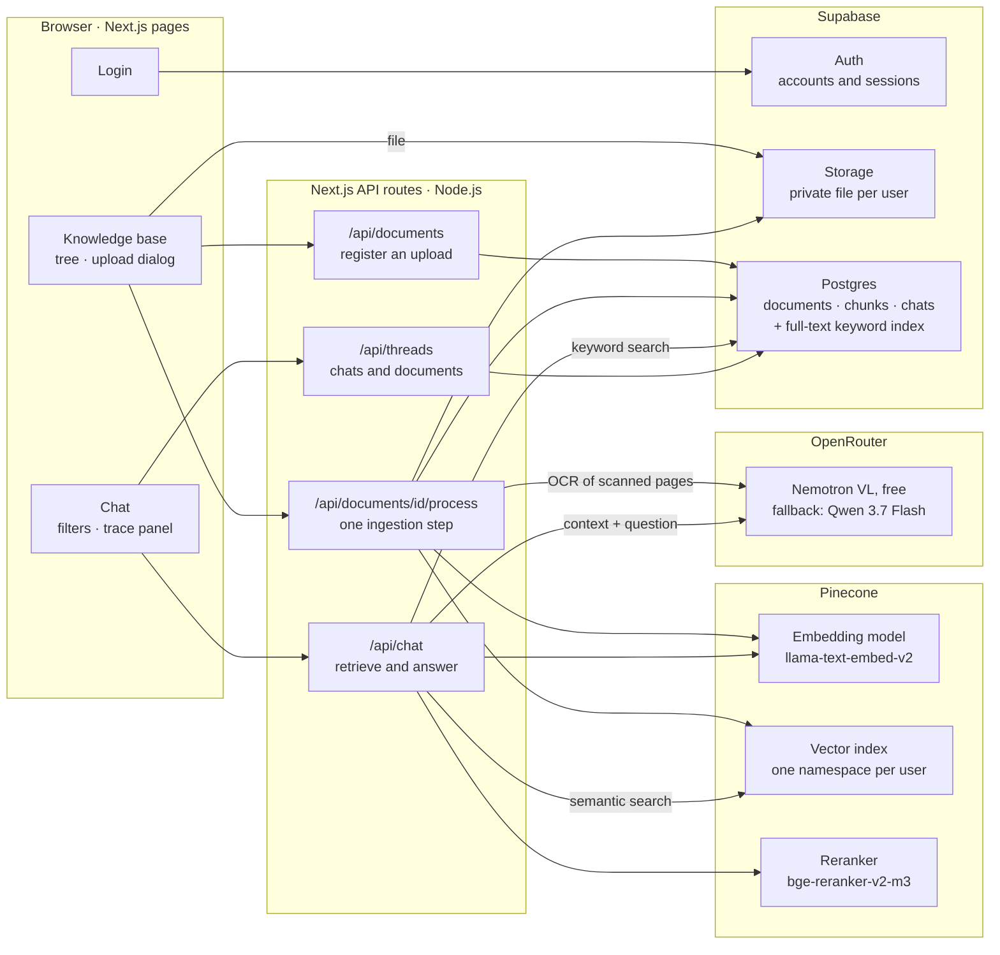
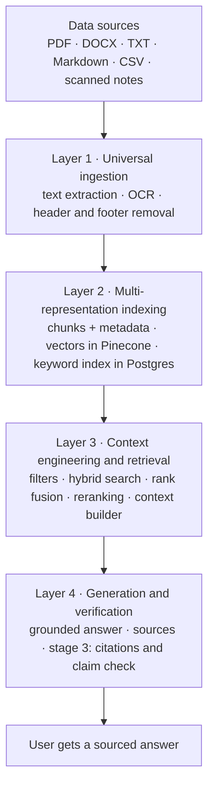
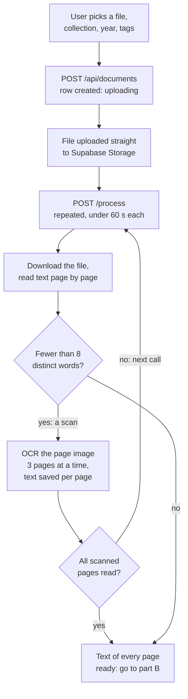
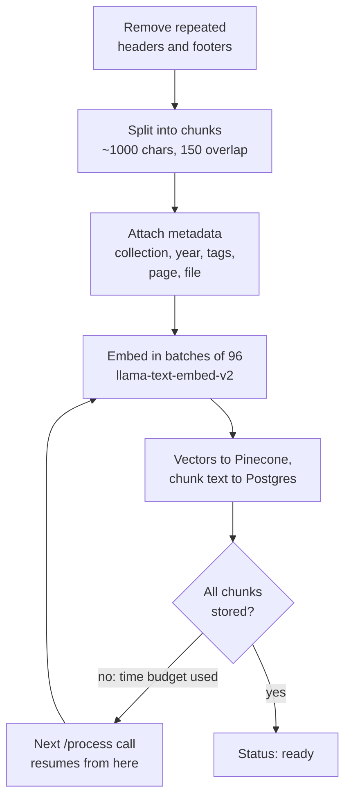
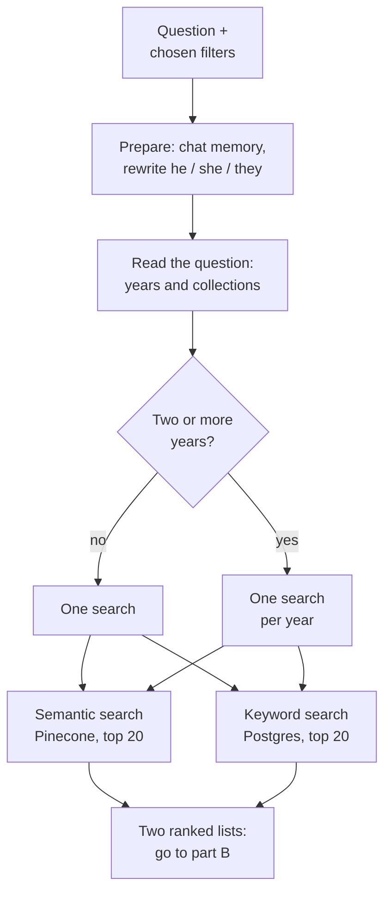
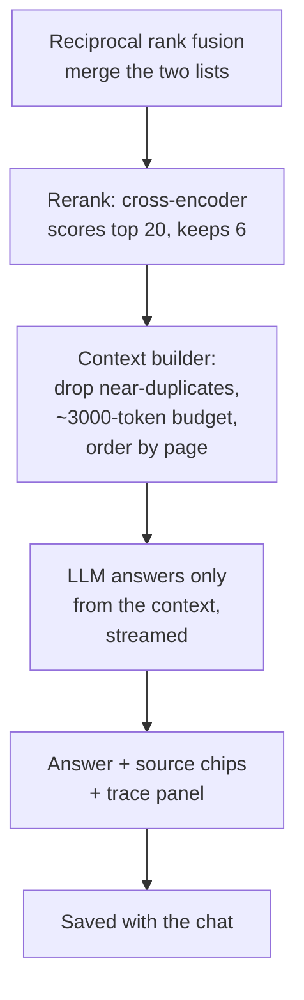
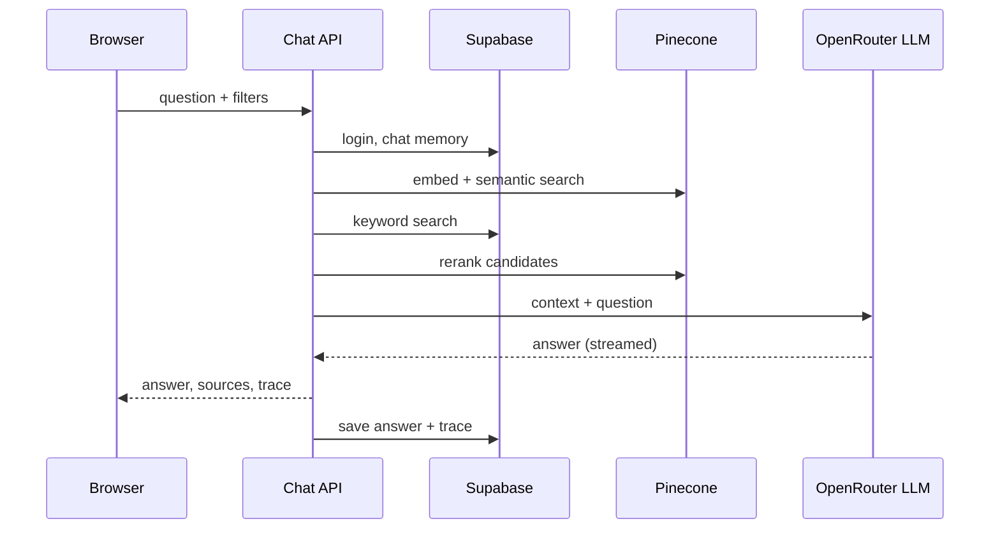
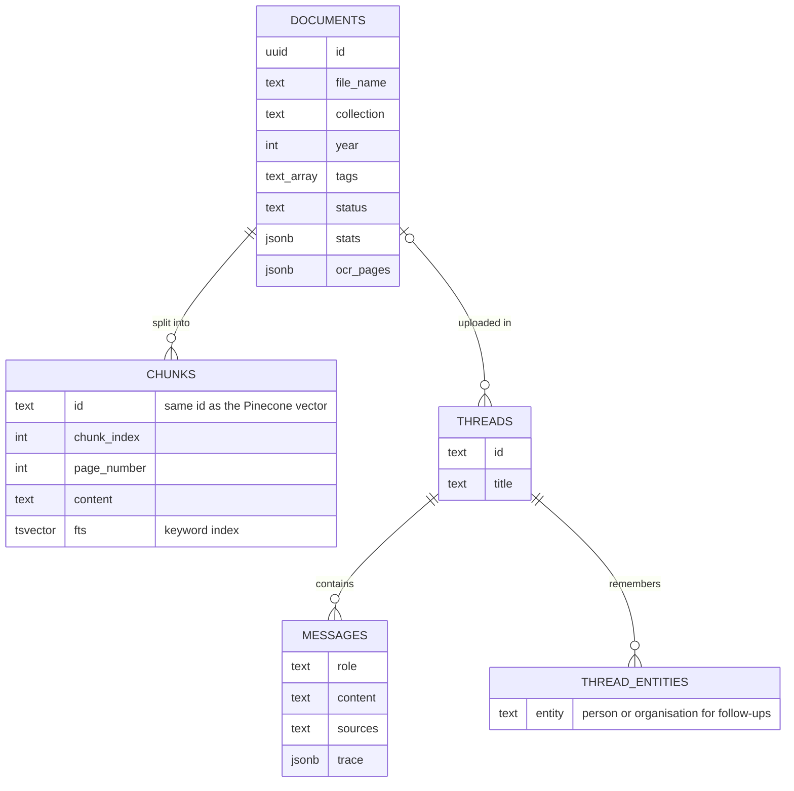

# RAGStack: architecture, models and logic

How the parts of RAGStack fit together, which models it uses, how a document becomes searchable, and
how a question becomes an answer, with the exact rules each step follows. Diagrams are Mermaid: they
render on GitHub, in VS Code (with a Mermaid extension) and at [mermaid.live](https://mermaid.live).
For the presentation script, see [PRESENTATION_GUIDE.md](PRESENTATION_GUIDE.md).

---

## 1. System architecture

| Part | Role |
|---|---|
| **Browser** | The pages the user sees. Files are uploaded straight to Supabase Storage, not through the server |
| **Next.js API routes** | The backend: check the login, run ingestion steps, run retrieval and call the LLM |
| **Supabase** | Accounts, the database (documents, chunk text, chats, traces), private file storage, keyword search |
| **Pinecone** | Turns text into vectors, stores them per user, and reranks search candidates |
| **OpenRouter** | One API for many LLMs: a free model reads scanned pages and writes answers; a cheap paid model steps in when it is busy or fails |

---

## 2. Models and services used

| Job | Model / service | Provider | Settings | Cost |
|---|---|---|---|---|
| **Writing answers** | `nvidia/nemotron-3.5-super-vl:free`, fallback `qwen/qwen3.7-flash` | OpenRouter | temperature 0.4, thinking off, streamed | Free; Qwen $0.03 / $0.13 per million input / output tokens |
| **OCR of scanned pages** | Same two models (both read images) | OpenRouter | temperature 0, thinking off, max 2,048 output tokens, 40 s timeout | Free; Qwen about $0.0001 per page |
| **Follow-up rewriting and chat memory** | Same two models | OpenRouter | temperature 0.2, thinking off | Free |
| **Answer claim check** (stage 3) | Same two models | OpenRouter | temperature 0.2, JSON output | Free |
| **Embeddings** | `llama-text-embed-v2` (1024 dimensions) | Pinecone Inference | `passage` mode for chunks, `query` mode for questions | Free on Pinecone Starter |
| **Vector database** | Pinecone serverless index, cosine metric | Pinecone | one namespace per user | Free on Starter |
| **Reranker** | `bge-reranker-v2-m3` (cross-encoder) | Pinecone Inference | top 20 in, best 6 out | Free on Starter |
| **Keyword search** | Postgres full-text search (`english` dictionary) | Supabase | `ts_rank_cd` ranking | Free plan |
| **Reading files** | pdf.js 1.10 (via `pdf-parse`), `mammoth` for DOCX, built-in CSV parser, `sharp` for page images | Local libraries | | Free |
| **Glue** | LangChain (model calls, text splitter, Pinecone store) | Local library | | Free |

OpenRouter tries the models in order and moves to the next one when a model errors or is overloaded.
Free models allow 1,000 requests a day once $10 of credit has been bought, and 20 a minute; the paid
fallback covers anything beyond that. All model testing and ingestion of three large PDFs on 30 October
cost $0.003.

---

## 3. The synopsis layers

---

## 4. Ingestion: from upload to searchable

**Part A: upload and read the text**

**Part B: clean, chunk and index**

### 4.1 Registering and uploading
1. The browser asks `/api/documents` to register the file. The server checks the type (PDF, DOCX, TXT,
   Markdown or CSV) and size (up to 50 MB), validates the year (1900 to 2100) and tags (up to 10), and
   creates a row with status `uploading`.
2. The browser uploads the file straight to Supabase Storage at `{user id}/{document id}.{ext}`. This
   avoids the serverless request-size limit and keeps every user's files in their own private folder.

### 4.2 Processing in steps
A serverless request may run for at most 60 seconds, so the browser calls `/process` again and again until
the status is `ready` or `failed`. Each call re-reads the file and continues where the last one stopped.
The status moves `uploading → parsing → embedding → ready`. Closing the tab is safe: the next page load resumes.

### 4.3 Reading text
- **PDF:** pdf.js reads every page; a new line starts wherever the text baseline changes.
- **DOCX:** `mammoth` extracts the raw text as one page.
- **TXT / Markdown:** read as one page.
- **CSV:** parsed (quoted fields and commas inside quotes handled), each row written as
  `column: value; column: value`, 50 rows per page.

### 4.4 Finding scanned pages
A PDF page counts as scanned when its text layer has **fewer than 8 distinct words**. Counting distinct
words, not characters, catches scans that carry a watermark: "Multi Atoms" repeated 12 times is 135
characters but only 2 words. The 126-page Cloud Computing notes have 101 such pages.

### 4.5 OCR (reading scanned pages)
1. Take the page's largest image (the scan) and convert it to a JPEG of at most 1600 px on its longest side.
2. Send it to the vision model with a prompt that asks for an exact transcription, keeping headings, lists,
   code and symbols, describing diagrams in [brackets], and leaving out printed DATE/PAGE boxes and notebook branding.
3. Read **3 pages at a time**, and start a new batch only in the first 10 seconds of a step so the step
   ends in time. Each page has a **40-second** limit and a **2,048-token** output cap.
4. **Loop protection:** a model can get stuck repeating a pattern (free Nemotron repeated `- ` on a page of
   dashed XML). Any 1 to 4 character unit repeated 10 or more times is shortened to 3 repeats, and a read
   that looped or hit the cap is redone on the fallback model.
5. **Retries:** a page that failed is retried in the next step on the fallback model. After 3 failures the
   document is marked failed with the reason, and Retry resumes from that page. If the free daily limit
   is used up, processing stops at once with a clear message instead of retrying.
6. Each page's text is saved as soon as it is read (`documents.ocr_pages`), so no page is ever read twice.
   A page where OCR finds nothing keeps its own text (for example a title).

### 4.6 Cleaning
- **Repeated headers and footers** (needs 3 or more pages): look at up to the first and last 3 non-empty
  lines of each page (never more than a third of the page). Compare lines by their letters only, so
  "Page 3" matches "Page 4" and "DATE [ ] [ ]" matches "DATE □ □ □". A line that appears at the edges of
  at least half the pages is removed, as is a line that is part of one (OCR sometimes splits "Red Wings
  PAGE" over two lines). Lines with fewer than 3 letters, like a closing `}`, are never removed.
  The Renewable Energy notes lost 259 such lines.
- **Whitespace:** Windows line endings normalised, stray one-character lines removed, runs of spaces and
  blank lines collapsed.

### 4.7 Chunking
LangChain's `RecursiveCharacterTextSplitter` splits each page into chunks of up to **1,000 characters with
150 characters of overlap**, preferring to break at paragraphs, then lines, then words. Chunks never cross
a page boundary (so every chunk has one page number), and chunks under 20 characters are dropped.
The overlap keeps a sentence that falls on a boundary readable in at least one chunk.

### 4.8 Metadata
Every chunk carries: document id, file name, page number, chunk index, total chunks, collection, year,
tags, upload time, a 200-character preview, and the user id. These are what filters and citations use.

---

## 5. Embedding and indexing

- **Model:** Pinecone's `llama-text-embed-v2` turns each chunk into a **vector of 1024 numbers** that
  captures its meaning. Chunks are embedded in `passage` mode and questions in `query` mode, as the
  model expects. Text past the model's limit is cut off at the end.
- **Batches:** 96 chunks per request (the model's limit). New batches start only in the first 40 seconds
  of a step, leaving room under the 60-second limit.
- **Vector store:** each vector is stored in Pinecone under the **user's own namespace**, with the
  metadata above. Its id is `{document id}#{chunk index}`, so re-running a batch after an interruption
  overwrites instead of duplicating. Similarity is **cosine**.
- **Keyword index:** the same chunk text goes into the Postgres `chunks` table, with a generated
  `tsvector` column (English stemming, so "operators" matches "operator") and a GIN index for fast search.
  Row-level security restricts it to the owner.
- **Deleting** a document removes its vectors (found by id prefix), its chunk rows, its file and its row.

---

## 6. Answering a question: retrieval and ranking (stage 2)

**Part A: understand the question and search**

**Part B: rank, build the context and answer**

### 6.1 Prepare
- Up to 10 recent messages of the chat are loaded from the database.
- **Follow-up rewriting:** if the question contains *he, she, his, her, their* or *them*, the LLM rewrites
  it using the person or organisation remembered from earlier answers ("what was his role?" becomes
  "what was *[the remembered name]*'s role?"). After each answer, the LLM extracts that main person or
  organisation and saves it for the next question.
- Limit: 10 questions per user per minute, to protect the model quota.

### 6.2 Reading the question (query understanding)
- Years (`19xx` / `20xx`) mentioned in the question are kept only if documents with that year exist, so a
  stray number can't filter everything out. A collection named in the question is detected the same way.
- What the user picked in the filter dropdowns always wins over what the question mentions.
- Two or more years switch to **comparison mode**: one full search per year, so each side gets evidence.

### 6.3 Filters (the namespace router)
The chosen collection, years and documents become a Pinecone metadata filter (`collection = X`,
`year in [..]`, `documentId in [..]`) and the same conditions in the SQL keyword search.

### 6.4 Semantic search
The question is embedded (query mode) and Pinecone returns the **20 closest chunks** by cosine similarity
within the user's namespace and the filter.

### 6.5 Keyword search
The SQL function `search_chunks_keyword` turns the question into search terms (English stemming, common
words dropped), joins them with **OR** so partial matches still count, and ranks matching chunks with
`ts_rank_cd`, which rewards chunks where the terms are frequent and close together. Top 20, same filters.
This finds exact codes, IDs and rare words that meaning-based search can miss (for example `PT-2027-0219`).

### 6.6 Reciprocal rank fusion
The two ranked lists are merged using positions only:

> **score(chunk) = Σ 1 / (60 + rank)** over the lists the chunk appears in

A chunk ranked 1st in both lists scores 1/61 + 1/61; one found by only one list scores at most 1/61.
Positions are used instead of raw scores because cosine similarity and `ts_rank_cd` aren't on the same scale.
The top 20 go to the reranker.

### 6.7 Reranking
`bge-reranker-v2-m3` is a **cross-encoder**: it reads the question and each candidate *together* and
outputs a relevance score from 0 to 1. That is sharper than comparing two separately made vectors, so it
reorders the candidates and the **best 6** are kept. In comparison mode each year is reranked separately
and keeps at least 3, so neither side is crowded out. If the reranker is unavailable, the fused order is used.

### 6.8 Context builder
1. Walk the candidates best first and **skip near-duplicates**: a chunk whose set of words overlaps 85% or
   more (Jaccard similarity) with one already picked. This caught a notebook page that was scanned twice.
2. Stop adding chunks once the context would pass **12,000 characters** (about 3,000 tokens: the context budget).
3. Order the kept chunks by file, page and chunk, so the model reads each source in sequence.
4. Label each one, for example `[2] report.pdf · 2026 · page 3`.

---

## 7. How the LLM answers

**Prompt rules** sent with every question:
- Answer **only** from the document context; never make up information.
- If the context doesn't contain the answer, reply exactly *"I couldn't find that in the uploaded document."*
- Only talk about a person if that person is named in the context.
- Be concise; each passage's label gives its source, year and page.
- For comparisons, answer side by side and say plainly when one side has no information.
- Stage 1–2: mention the page in prose ("According to page 46…"). Stage 3: cite passages as `[1]`, `[2][3]`.

**Input:** the rules, the last 6 messages of the chat, the labelled context and the question.

**Model call:** Nemotron VL (free) through OpenRouter at temperature 0.4 with thinking off (it otherwise
writes thousands of hidden tokens first), falling back to Qwen 3.7 Flash; up to 2 retries. The answer is
**streamed** to the browser word by word.

**After the answer:**
- **Sources:** a "couldn't find" answer shows none. Otherwise the chips list the passages in the context
  (stage 3: only the ones the answer cites).
- **Trace:** the query, filters, searches, every chunk's ranks and scores, the model and the time per stage
  are sent to the browser and saved with the message.
- **Claim check (stage 3):** a second LLM call splits the answer into up to 8 claims and marks each as
  supported or not by the passages, returned as JSON; the result shows as "✓ 4 of 4 claims supported".

---

## 8. One chat request, step by step

---

## 9. Data model

Every table also has a `user_id`, and row-level security lets each user see only their own rows.

---

## 10. Why these models: test results (27–30 October 2026)

**OCR of handwritten notes**

| Test | Result |
|---|---|
| Tesseract (classic OCR) on cursive notes | Confidence 30/100, unreadable output: rejected |
| Free Nemotron VL, thinking on | Accurate but 34–57 s per page (thousands of hidden "thinking" tokens) and frequent timeouts |
| Free Nemotron VL, thinking off | **2.3 s per page**, accuracy 0.95–0.98; loops on rare pages (dashed XML) |
| Qwen 3.7 Flash (paid) | 4–9 s per page, the most faithful on tables, never looped |
| DeepSeek V4.1 Flash (paid) | Fast, but invented a margin note that wasn't on the page |
| Gemini 2.5 Flash-Lite (paid) | Fastest and cheapest per page, but shifted a table column by one row |

**Answering:** all four models gave correct, correctly cited answers on the same context, so the free
model answers and the paid one is only a fallback.

**Big files:** a 278-page PDF was ready in 61 s (280 chunks); a 31 MB, 126-page PDF with 101 handwritten
scanned pages was fully OCR-ed and indexed (148 chunks, three times the text its own text layer had).
Every test question was answered correctly with the right page.

---

## 11. What each stage shows

| Feature | Stage 1 | Stage 2 | Stage 3 |
|---|:-:|:-:|:-:|
| Upload with steps, OCR, header removal, chunking, embedding | ✅ | ✅ | ✅ |
| Knowledge base tree with metadata | ✅ | ✅ | ✅ |
| Semantic search, grounded answers, source chips, "not found" refusal | ✅ | ✅ | ✅ |
| Chat memory and follow-up rewriting | ✅ | ✅ | ✅ |
| Basic trace (query, similarity-ranked chunks, timings) | ✅ | ✅ | ✅ |
| Filters by collection, year, document ("Ask about this in chat") | | ✅ | ✅ |
| Keyword search + reciprocal rank fusion | | ✅ | ✅ |
| Reranking | | ✅ | ✅ |
| Year detection and per-year comparison searches | | ✅ | ✅ |
| Full trace (S/K ranks, rerank scores, searches) | | ✅ | ✅ |
| Inline `[n]` citations | | | ✅ |
| Claim-by-claim answer check | | | ✅ |
| Evaluation page | | | ✅ |

Set with `NEXT_PUBLIC_DEMO_STAGE` in `.env.local` (currently 2), then restart the dev server.

---

## 12. Where each part lives in the code

| Part | File |
|---|---|
| Upload dialog and its steps | `components/upload/UploadDialog.tsx` |
| Knowledge base page and tree | `app/knowledge/page.tsx`, `components/knowledge/NodeDetail.tsx` |
| Chat page, filters, trace panel | `app/page.tsx`, `components/chat/ChatShell.tsx`, `components/chat/TraceDetails.tsx` |
| Ingestion steps | `lib/rag/ingest.ts`, `app/api/documents/[id]/process/route.ts` |
| Reading PDFs and page images | `lib/pdf/pdfjs.ts`, `lib/pdf/loader.ts` |
| OCR | `lib/pdf/ocr.ts` |
| Header/footer removal, scan detection, CSV, loop trimming | `lib/pdf/parse.ts` |
| Chunking and metadata | `lib/rag/chunking.ts`, `lib/rag/metadata.ts` |
| Embeddings and Pinecone | `lib/ai/embeddings.ts`, `lib/pinecone/vector-store.ts` |
| Models and fallbacks | `lib/ai/model.ts` |
| Follow-up rewriting and memory | `lib/rag/query-rewrite.ts`, `lib/rag/memory.ts` |
| Query understanding | `lib/rag/query-understanding.ts` |
| Semantic search and filters | `lib/rag/retrieve.ts` |
| Keyword search | `lib/db/chunks.ts`, `search_chunks_keyword` in `supabase/schema.sql` |
| Rank fusion, reranking, orchestration | `lib/rag/fusion.ts`, `lib/rag/rerank.ts`, `lib/rag/hybrid.ts` |
| Context builder | `lib/rag/context.ts` |
| Answer generation and prompts | `lib/rag/answer.ts`, `lib/ai/prompts.ts` |
| Claim check (stage 3) | `lib/rag/verify.ts`, `lib/rag/claims.ts` |
| Chat API | `app/api/chat/route.ts` |
| Stage switch | `lib/stage.ts` |
